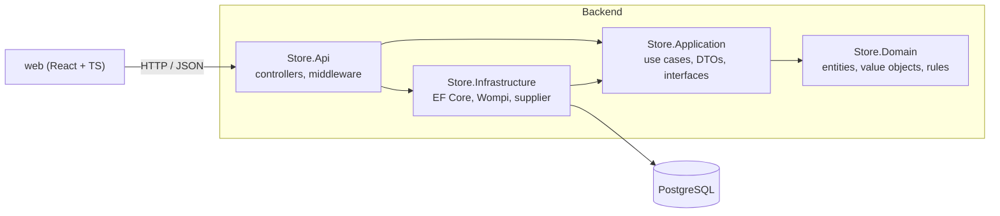

# Pet Store

[](https://github.com/SamuelMarino2108/pet-store/actions/workflows/ci.yml)

Online store for dog and cat accessories, built from scratch with a dropshipping model and aimed at the Colombian market.

> **Demo store.** This is a portfolio project: nothing is sold for real, payments run in sandbox and the supplier is simulated. Do not enter real personal data.

## The problem

A small dropshipping store has to answer questions that a basic CRUD does not:

- **Is each product profitable?** The store keeps the supplier's cost next to the sale price and calculates the margin, including manual discounts.
- **What did the customer actually pay?** Order lines keep a snapshot of name, cost and price at purchase time, so reports never depend on today's catalog.
- **Where is my order?** Guest customers track orders with an unguessable code. States move from payment to the supplier to delivery.
- **Which categories sell?** A sales dashboard groups revenue, cost and margin by category and product.

The full business rules are in [`docs/domain.md`](docs/domain.md).

## Architecture

Layered architecture with dependencies pointing inwards: the domain has no dependencies, and infrastructure details (database, payment gateway, supplier) sit behind interfaces.



| Layer | Contents |
| --- | --- |
| `Store.Domain` | `Product`, `Category`, `Money`, `Sku`. Rules are enforced here and invalid states throw `DomainException`. |
| `Store.Application` | Use cases and the ports the infrastructure implements. Empty for now: the first use cases arrive in phase 2, and ports such as `IPaymentGateway` and `ISupplierGateway` in later phases. |
| `Store.Infrastructure` | `StoreDbContext`, EF Core mappings and migrations. |
| `Store.Api` | HTTP endpoints, `ProblemDetails` error handling, `/health`, OpenAPI. |

## Tech stack

- **Backend:** .NET 10, ASP.NET Core, EF Core 10, PostgreSQL 17
- **Frontend:** React, TypeScript, Vite, Tailwind, TanStack Query *(phase 2)*
- **Tests:** xUnit v3, Testcontainers
- **Infra:** Docker Compose, GitHub Actions
- **Payments:** Wompi sandbox *(phase 4)*

## Getting started

### Requirements

- [.NET SDK 10](https://dotnet.microsoft.com/download)
- [Docker](https://www.docker.com/) (for the database and the integration tests)

### Run everything with Docker Compose

```bash
cp .env.example .env   # optional, defaults work for local development
docker compose up --build
```

- API: http://localhost:8080
- Health check: http://localhost:8080/health
- API reference (Scalar): http://localhost:8080/scalar

Migrations are applied when the API starts.

### Run the API from the IDE or the CLI

```bash
docker compose up -d db
dotnet run --project src/Store.Api
```

The development connection string in `appsettings.Development.json` points to the Compose database. Its credentials are local-only defaults, not secrets.

### Tests

```bash
dotnet test
```

Domain tests run without dependencies. API tests start a PostgreSQL container, so Docker must be running.

### Database migrations

```bash
dotnet tool restore
dotnet ef migrations add <Name> -p src/Store.Infrastructure -s src/Store.Api -o Persistence/Migrations
```

## Repository layout

```
src/                 Backend projects (Domain, Application, Infrastructure, Api)
tests/               Unit and integration tests
docs/domain.md       Business rules
docs/adr/            Architecture decision records
.github/workflows/   CI pipeline
```

## Technical decisions

Each important decision is recorded as an ADR:

- [0001 - Supplier integration behind `ISupplierGateway`](docs/adr/0001-supplier-integration.md)
- [0002 - Persistence with EF Core and PostgreSQL](docs/adr/0002-persistence-with-ef-core-and-postgresql.md)
- [0003 - Testing strategy](docs/adr/0003-testing-strategy.md)

## Roadmap

1. ✅ Solution structure, catalog domain model, Docker Compose and CI
2. Catalog API, seed data, product list and detail pages
3. Cart and guest checkout with tracking code
4. Wompi sandbox payments and webhooks
5. Authentication, admin panel and sales dashboard
6. Notifications, simulated supplier and demo deployment
